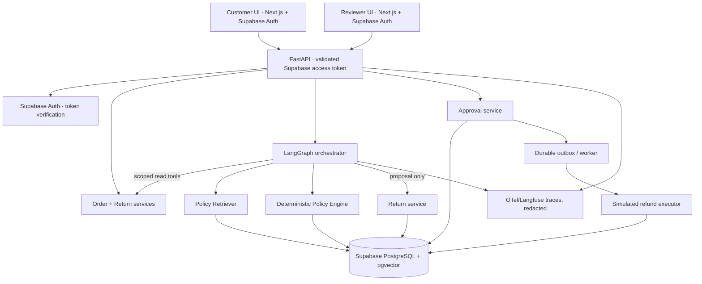

# 04 — System Architecture (C4-lite)

## Guiding principles

- **LLM is an untrusted recommender**, never business authority.
- **Services own state and money invariants.** Only internal service can write simulated ledger.
- **One orchestrated workflow**, not many chat agents.
- **Evidence lineage**: every policy decision has input facts, policy version, rule IDs and trace ID.
- **Clean failure:** unavailable LLM or retrieval → no write; customer can still access order/status.

## Logical components

Reference diagram: [`../assets/architecture.mmd`](../assets/architecture.mmd).

## C4 containers and responsibilities

| Container | Responsibilities | Trust boundary |
|---|---|---|
| Next.js web | UI state, login via Supabase Auth SSR, order selection, review workflow | Only publishable key; browser never writes business tables |
| Supabase Auth | Authentication, access/refresh token lifecycle | `auth.users.id` verified and mapped to app user; JWT `role` is NOT app RBAC |
| FastAPI | Request auth, tenant scope, validation, endpoints, domain orchestration | Authenticated API boundary |
| Domain services | Policy engine, return transition validation, approval, ledger transaction | Authoritative backend |
| LangGraph | Structured dialogue and tool sequencing, pause/resume, clarification | LLM decisions are untrusted |
| Retrieval service | Version-filtered policy chunk retrieval | Source docs are lower-trust data |
| Supabase PostgreSQL | Orders, returns, approvals, simulated ledger, audit, policies, checkpoints | Durable transactional source; Data API blocked for business tables |
| Worker/outbox | Retry approved simulated refund, idempotently | Narrow internal permission |
| Tracing / eval | Masked traces, datasets, experiment comparison | Never store credentials or raw payment data |

## Deployment view

**Local MVP:** Supabase CLI starts the local Postgres/Auth stack using Docker; API, web and optional worker run separately (or via an app-only Compose file). Do not run a second standalone Postgres container. Optional Langfuse Cloud / self-hosted Phoenix for traces; disable external telemetry when running confidential workloads. **Demo deploy:** isolated development environment with synthetic fixtures, HTTPS, access-limited reviewer UI and rate limits. Do not expose an unauthenticated reviewer endpoint. Demo has no external refund credentials.

## Request path and separation

1. Browser signs in with Supabase Auth (SSR); sends access token to FastAPI; API validates it with Supabase Auth, maps `sub` to active `users.auth_user_id`, resolves application role and tenant from the DB.
2. Customer message calls `POST /v1/conversations/{id}/messages` and stores sanitized text.
3. API loads authoritative user/tenant/order context server-side; invokes LangGraph with stable `thread_id`.
4. Graph asks for missing info, calls read tools, retrieves policy evidence, generates an **intent/proposal**.
5. Policy engine recomputes rules on authoritative facts; ignores any LLM-supplied `eligible=true`.
6. Domain service stores return with policy/version/amount snapshot in a transaction.
7. Reviewer uses separate authenticated approval endpoint; service checks role, conflicts and immutable proposal hash.
8. Worker locks approved request row and commits **one** mock refund ledger record + outbox completion + audit record.
9. UI polls status or receives event; source of truth always the DB status.

## Persistence and checkpointing

Use a durable LangGraph checkpointer backed by Supabase Postgres for `thread_id`, never in-memory in deployed demo. `thread_id` is a server-generated UUID bound to `conversation_id` and customer identity; never accept a different owner's thread ID from a request. Agent state is *not* a substitute for business DB records. A graph interrupt can support reviewer approval UX, but approval must also be persisted by ApprovalService in business tables before resume. Restarts/replays must be safe because externally observable writes use idempotency keys.

## Approval and outbox atomicity

Within the approval transaction, insert `approvals` and update return from `PENDING_APPROVAL` to `APPROVED`, then insert a durable outbox event. A worker claims event, rechecks request state/version, inserts unique ledger record, moves to `REFUNDED`, appends audit and marks outbox done within a transaction; retries are safe. **Never** perform irreversible business writes before a graph interrupt without idempotency.

## Concurrency

- Write paths use DB transaction + `SELECT ... FOR UPDATE` on `return_requests`.
- Unique `(tenant_id, return_request_id)` on `mock_refunds` protects at most one issued ledger refund per case.
- Unique idempotency key per `(tenant_id, operation, key)`; same key+different payload returns `409 IDEMPOTENCY_CONFLICT`.
- Optimistic `version` on return cases can prevent stale reviewer screens from committing; re-fetch on mismatch.
- Approval proposals use SHA-256 over canonical immutable business fields; hash alone is not authorization.

## Failure scenarios

| Failure | Expected behavior |
|---|---|
| LLM timeout | Prompt to retry; no mutation; timeout trace |
| RAG empty/wrong version | `MANUAL_REVIEW`, not confident policy claim |
| DB temporarily unavailable | 503; never lie about case creation |
| Reviewer approves stale proposal | 409; reload proposal |
| Worker retries after crash | Same mock refund ledger; no duplicate |
| Policy changed after order | Use order-bound historical published policy |
| Another customer submits ID | 404; no existence leak |
| Injection in retrieved text | Treated as data, not instruction; no privilege elevation |

## Deferred scaling decisions

Start with simple exact vector or even FTS search on tiny policy corpus. Add hybrid retrieval/reranking only after eval demonstrates need. Start worker with Postgres outbox polling, not Kafka. One tenant MVP. Enable RLS on all business tables now because Supabase exposes `public` by default; expose no direct browser CRUD, and revisit customer-scoped policies before SaaS/multi-tenant expansion.

## Supabase connection and ownership model

- Next.js `@supabase/ssr` handles login/session; **only** publishable key is accessible to client.
- Browser calls FastAPI with the Supabase access token; FastAPI verifies identity through Auth API, then loads `public.users` by `auth_user_id` and checks `is_active`, tenant, role and ownership.
- FastAPI uses a **server-only Postgres connection** for transactions and row locks; do not replace refund logic with a client-side `supabase.from(...).insert()` call or an unguarded RPC.
- Hosted deployment uses Supabase managed PostgreSQL. For persistent FastAPI prefer a direct DB connection if IPv6 works; use session pooler if IPv4-only. Transaction pooler can require disabling prepared statements and testing driver compatibility.
- All public business tables have RLS enabled and lack direct `anon`/`authenticated` privileges. Privileged SQL connections can bypass RLS; service authorization is mandatory and must be independently tested.
- Local migrations: Supabase CLI `supabase/migrations/*`, not Alembic. Do not maintain two parallel migration histories.

See [21_SUPABASE_IMPLEMENTATION.md](21_SUPABASE_IMPLEMENTATION.md).
