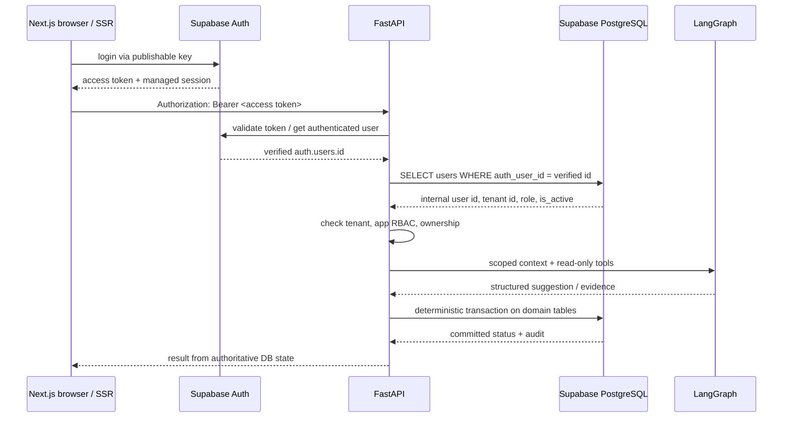

# 21 — Supabase Implementation Specification (v1.1)

**Decision:** Supabase-managed PostgreSQL is the single source of transactional truth. Use Supabase Auth for login and PostgreSQL's `vector` extension for optional RAG. FastAPI and LangGraph remain. **This document does not provision a project or execute SQL.**

## 1. End-to-end trust flow



`auth.users.id` is an identity ID. `public.users.id` is the application domain ID. `public.users.auth_user_id` binds them (UNIQUE/FK). Supabase JWT `role=authenticated` is not equivalent to `reviewer` and cannot authorize approvals.

## 2. Updated stack and responsibility matrix

| Component | Tech | Privileges / responsibility |
|---|---|---|
| Web app | Next.js, `@supabase/supabase-js`, `@supabase/ssr` | Supabase Auth login, display business API responses; publishable key only |
| API | FastAPI, Pydantic, SQLAlchemy + psycopg | Validates bearer token through Supabase Auth; DB app-role lookup; all business APIs, authorization, transactions |
| Agent | LangGraph | Tools for server-scoped reads and policy evidence; **no direct privileged SQL/mutation tools** |
| Database | Supabase PostgreSQL | Orders, rules, return state, mock ledger, approval, audit, durable outbox/checkpoints |
| Retrieval | Postgres FTS + optional `extensions.vector` | Policy version-aware scoped retrieval; no direct browser Data API |
| Worker | Python process over server-only SQL connection | Durable idempotent mock refunds after reviewer approval |
| Deployment | Supabase hosted DB/Auth + hosted FastAPI/Next.js | Independent server lifecycle; HTTPS, env secrets and CI gates |

## 3. Supabase setup / migration source of truth

The `supabase/` directory must be created by the **installed CLI**, not copied from generated placeholders. Commands below are examples to be verified with `supabase --help` for your CLI version.

```bash
supabase --version
supabase init
supabase start
supabase status
supabase migration new init_returnops
# Into CLI-created timestamped migration: reviewed contracts/db_schema.sql
# followed by contracts/supabase_rls.sql
supabase db reset --local
```

Next, create synthetic users via a **secure bootstrap** using Supabase Auth Admin operations from a local-only script, never by raw INSERT into `auth.users`. Seed domain tables from `contracts/seed_data.json` and bind `auth_user_id`. Add a local `supabase/seed.sql` file only when scripts have been implemented and verified. Avoid `supabase db push` to remote until dev SQL/RLS tests pass and the target is explicitly confirmed.

Do **not** maintain SQLAlchemy Alembic migrations alongside Supabase SQL migrations. SQLAlchemy remains fine as query/ORM layer. Generated LangGraph checkpoint structures require separate pinned-version setup and security review if created in any Data-API-exposed schema.

## 4. Environment variable contract

See [`../examples/.env.supabase.example`](../examples/.env.supabase.example).

| Variable | Scope | Meaning |
|---|---|---|
| `NEXT_PUBLIC_SUPABASE_URL` | browser + SSR | Supabase URL; intentionally public |
| `NEXT_PUBLIC_SUPABASE_PUBLISHABLE_KEY` | browser + SSR | publishable API key; not secret |
| `SUPABASE_URL` | FastAPI | Supabase project/Auth URL for token validation |
| `SUPABASE_PUBLISHABLE_KEY` | FastAPI | API key used by server Auth SDK where required |
| `DATABASE_URL` | FastAPI/worker **secret** | Connection URL from dashboard Connect or local `supabase status`; never browser |
| `LLM_API_KEY` | FastAPI only **secret** | Model provider key; optional for deterministic tests |
| `REFUND_MODE` | FastAPI/worker | Must remain `simulation_only` |

No required Supabase `service_role` or secret API key for ordinary MVP requests. If later needed for bootstrap/admin tasks, give it only to narrowly scoped server-side tooling. Never prefix server-only secrets with `NEXT_PUBLIC_`.

## 5. Authentication adapter contract

**Frontend:** configure Supabase SSR client for Next.js sessions using current `@supabase/ssr` docs; forward access token to FastAPI's `Authorization` header. Handle token refresh within supported session flow. UI is not an authorization authority.

**FastAPI request dependency (language-neutral pseudocode):**

```text
authHeader = requireBearer(request)
supabase_user = SupabaseAuth.verify_or_get_user(authHeader.token)
if supabase_user invalid or not confirmed (per auth policy): 401
actor = SELECT id, tenant_id, role, is_active
        FROM public.users WHERE auth_user_id = supabase_user.id
if actor absent or inactive: 403
return AuthContext(user_id=actor.id, tenant_id=actor.tenant_id, role=actor.role)
```

Use official verified Auth server calls initially; alternatively adopt JWKS validation later with correct issuer, allowed algorithms, expected audience, key rotation and expiry checks. NEVER merely decode an unverified JWT. Never accept `role`, `tenant_id`, `user_id` from browser/LLM, or from mutable `user_metadata`. Supabase `app_metadata` also has token-refresh staleness; DB `users.role` is authoritative for immediate approval revocation.

## 6. Row Level Security / Data API boundary

For MVP, **all business interactions go through FastAPI**. No direct `supabase.from('orders')`, `.from('approvals')`, `.rpc('issue_refund')`, or `supabase.from('mock_refunds')` from browser. There is no frontend browser-to-business-table RLS policy in v1.1.

Every table in exposed `public` MUST have RLS enabled; `anon` and `authenticated` have no direct table privileges/policies for ReturnOps. This is a deliberate deny-all stance. The reference SQL is [`../contracts/supabase_rls.sql`](../contracts/supabase_rls.sql).

**Critical limitation:** service-role API keys and privileged Postgres connections can bypass RLS, so all SQL in FastAPI/worker still requires application RBAC, tenant/ownership scopes, constraint-backed idempotency and audited write services. A real-data launch must further restrict DB role privileges and validate RLS/tenant isolation across all access paths.

If later adding direct customer queries: define SELECT/INSERT/UPDATE policies with real ownership (`auth.uid()` mapping) and `WITH CHECK` for writes, not only `TO authenticated`. Reviewer/admin write abilities should still remain in FastAPI; never grant direct public mock-refund execution. Changes require ADR and tests.

## 7. Data and pgvector

- Business schema in `public`, locked behind RLS/GRANT; optional `extensions.vector` with dimension matching the chosen embeddings (reference `1536` is not a fixed model commitment).
- Use direct parameterized SQL/SQLAlchemy for scoped reads and transactions; policy retrieval first filters `tenant_id` + order-bound published `policy_version_id`.
- Upsert/checkpoint or outbox processing must have idempotency keys and transaction boundaries; Supabase Realtime subscriptions are not needed in MVP.
- Keep `mock_refunds` **simulated ledger records**, never payment processor calls.
- Large evidence attachments may later use Supabase Storage with private buckets and distinct access policy review; not required in MVP.

## 8. DB connection strategy and poolers

Supabase's connection chooser differentiates direct (persistent servers), shared session pooler (IPv4-only persistent) and transaction pooler (many short-lived/serverless). Choose an actual URL from project **Connect**; hostnames are project-specific. Transaction mode does **not** support prepared statements—ensure the driver disables them and is validated before choosing it. For the first deployed persistent FastAPI instance, direct/session mode is simpler. Migrations use a privileged/admin connection but should never run on user request paths.

Avoid a second local Postgres. Avoid mixing hosted Supabase's API URL with PostgreSQL `DATABASE_URL`—one is HTTP API, the other is SQL protocol. Manage separate dev/test/prod projects and secrets.

## 9. Acceptance checklist for integration

- [ ] Local Supabase Auth and SQL instance launch and reset reproducibly.
- [ ] DB schema migration applies with `extensions.vector` available; RLS enabled for all business tables.
- [ ] `anon` + `authenticated` cannot read/write business tables via Data API.
- [ ] Customer-a and reviewer-1 have real **synthetic** Supabase Auth identities mapped to domain users.
- [ ] `user_metadata.role='reviewer'` does not elevate privileges; unbound/inactive account denied.
- [ ] Foreign user order ID returns 404 from FastAPI; tenant scope enforced.
- [ ] Duplicate or concurrent approve/refund operations issue at most one simulated ledger row.
- [ ] Backend/worker can connect with configured DB URL; no secret in bundle or logs.
- [ ] Migration, Auth, RLS and outbox tests pass in CI; no live money movement.

## 10. Deferred design choices

- Do not enable direct browser data CRUD, Supabase Realtime, Supabase Storage, Edge Functions or serverless workers unless a measured requirement emerges.
- Do not assume Supabase plan pricing or quota without checking provider's current plan.
- Do not claim the reference SQL is deploy-ready or an RLS security audit is complete before executing test suite against actual Supabase.

## Sources

- https://supabase.com/docs/guides/local-development/cli-workflows
- https://supabase.com/docs/guides/database/postgres/row-level-security
- https://supabase.com/docs/guides/api/securing-your-api
- https://supabase.com/docs/guides/auth/server-side/nextjs
- https://supabase.com/docs/guides/database/connecting-to-postgres
- https://supabase.com/docs/guides/database/extensions/pgvector
- https://supabase.com/changelog
